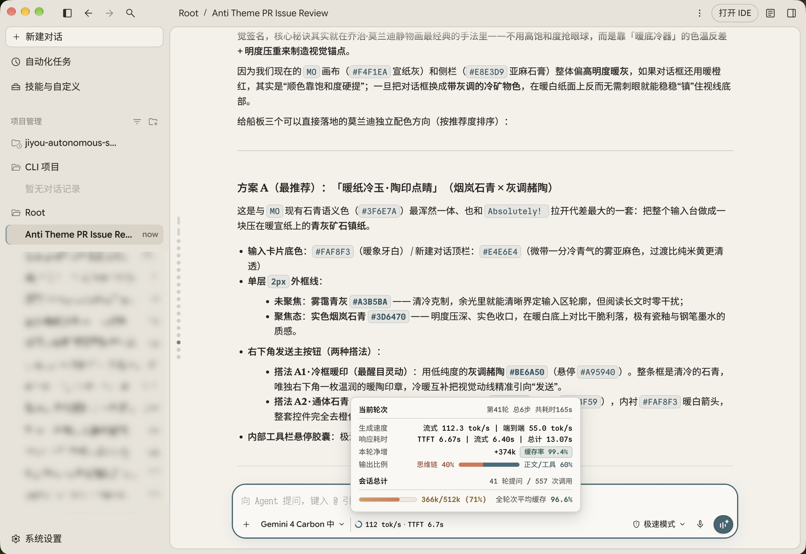
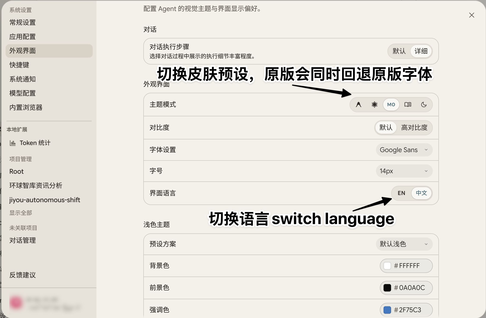
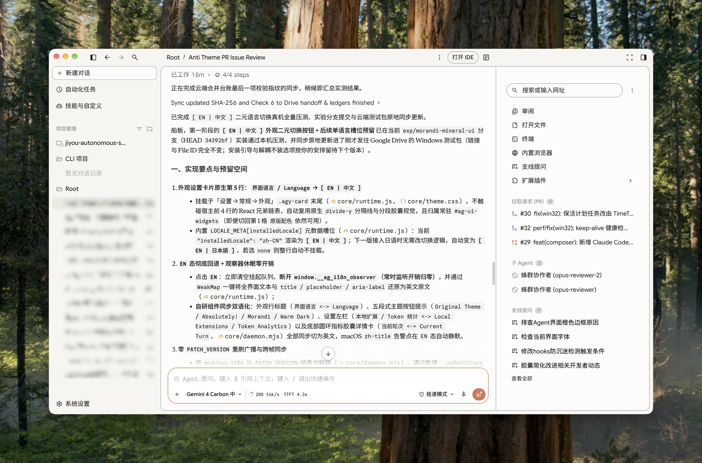

# 船板的 Antigravity 主题、字体与汉化补丁 (v6.0.0)

[](https://github.com/henrychou0312/chuanban-antigravity-theme)
[](https://github.com/henrychou0312/chuanban-antigravity-theme)
[-339933.svg)](https://nodejs.org/)
[](https://github.com/henrychou0312/chuanban-antigravity-theme)
[](LICENSE)

面向 **macOS** 版 Google Antigravity（支持最新 **`2.34.0+`**）的轻量级非侵入式外观、排版、汉化与本地只读统计增强补丁（macOS 专属精简与安全加固版）。内置全新默认**莫兰迪古典矿物风格（`morandi`）**、五段式外观切换 **`[ A | ✳️ | MO | 📖 | 🌙 ]`**、**`[ EN | 中文 ]`** 一键零重刷语言双切、四层中西文混排与活字润墨、1,965 条零冲突汉化、极简上下文圆环遥测胶囊及「Token 统计」多维分析面板；不修改客户端 `.asar` 与系统签名，零第三方 npm 依赖，由 AI Agent 一键部署并通过 `user/` 层实现 `2.5s` 热重载定制。

> 供 AI Agent 读取的完整部署与改装技术契约见仓库根目录 **[`SKILL.md`](https://github.com/henrychou0312/chuanban-antigravity-theme/blob/main/SKILL.md)**，完整版本演进见 **[`CHANGELOG.md`](CHANGELOG.md)**。

---

## ✨ 核心特性（v6.0.0 · macOS 专属安全加固版）

- **多套打磨风格自由切换**：内置温润耐看的**莫兰迪古典矿物风格**（默认）、深度打磨的**仿 Claude 书卷暖白风格（`Absolutely！`）**、护眼的**温润书卷夜间风格（`claude-warm`）**与深海冷碳深色模式（`onyx`），并支持在设置面板一键切回**官方原版风格（`A`）**（`<1ms` 硬件级旁路补丁配色与自定义字体）。
- **母语级汉化与中英一键双切**：1,965 条零冲突词典覆盖主界面、15+ 设置子页、编排器模型档位与子 Agent / Swarm 副栏，严格隔离代码块、行内文件胶囊（`.inline-pill[data-uri]`）、Monaco 编辑器、终端与英文历史标题；外观面板提供独立 **`[ EN | 中文 ]`** 按钮，可随时一键零重刷退回纯英文原版界面（`EN` 态自动休眠文本观察器零开销）。
- **字体美化与 macOS 活字润墨质感**：UI 西文直连官方 `Google Sans Flex` 可变字体引擎（`#ag-font-faces` 常驻隔离防切肤缺字）× `AgSarasaUI` 更纱黑体精密字重桥接；对话正文与 Markdown 采用 `Anthropic Serif` + `Sarasa Mono Slab SC` 衬线；代码与文件胶囊采用 `Anthropic Mono` 等宽；主输入框采用打字机板状粗衬线配单层 `2px` 同心合并边框，并在浅色纸面融入细腻的活字微润墨效果。
- **极简美观的上下文圆环信息胶囊**：在输入框底栏内嵌低干扰状态胶囊（支持主窗口、多路平铺分屏、`/btw` 支线提问与子 Agent 侧栏独立计量），默认展示上下文占用圆环、生成速率与首字延迟，悬停展开精简 4 行矿石色中英双语遥测详情卡（如需旧版完整行内指标，可在 `user/config.json` 中配置 `"metricsMode": "full"`）。
- **后台深度「Token 统计」多维分析面板**：基于 Node.js `>= 22.13` 原生 `node:sqlite` 只读增量引擎，在「系统设置 → 本地扩展 → Token 统计」提供 4 口径 KPI、26 周贡献热力图、近 14 日堆叠趋势、模型/配额池、工作场景及父子会话归因；内置 `.cache/token-analytics-index.json` 私有磁盘持久化索引（重开毫秒级响应，按住 `Shift` 点击「刷新」强制全量重算），Swarm 子帧及关闭 `modules.tokenAnalytics` 时自动剥离 ~100 KB 载荷。
- **流畅不卡顿的渲染与守护优化**：全面清除 `body:has()` 与全局 `:nth-child():has()` 并为侧栏虚拟滚动容器补齐实色底，消除快速滚动闪烁；Browser 级 CDP 事件发现（`Target.setDiscoverTargets`）实现新建/唤醒窗口与 Swarm 子帧毫秒级注入并削减 83% 轮询；空闲时基于 `SingletonLock` 软链 PID 预检实现 0 次 `ps` 派生；`install.mjs` 自动将 Homebrew / `fnm` Node 还原为稳定软链写入 LaunchAgent；单图标纯净模式 + `M2` 冷启动无感接力与 `2.5s` 热重载。
- **运行时完整性与最小权限安全加固**：守护进程在启动（含 `--keep-alive` 接管路径）及每次内核热重载前强制逐字节校验 `core/manifest.json` 的四件套 SHA-256 与文件大小（篡改即拒载）；移除 `user/custom.js` 动态 JS 执行（`new Function`）与外部 Python 脚本自动拉起；安装目录、配置、plist、`.cache/` 索引与私有日志统一收紧为属主独占权限（`0700` / `0600`），并支持 `node install.mjs install --no-service` 无常驻后台安装模式。

---

## 🎨 配色与主题体系

在「系统设置 → 外观界面」可直接通过五段式胶囊 **`[ A | ✳️ | MO | 📖 | 🌙 ]`** 切换全局风格，并可通过独立 **`[ EN | 中文 ]`** 按钮一键切换界面语言：

| 按钮 | 预设名称 | 风格定位 |
| :---: | :--- | :--- |
| **`MO`** *(默认)* | **莫兰迪色** (`morandi`) | **暖底冷器 · 耐看静物感**：暖宣纸浅灰画布 `#F4F1EA` 搭配亚麻石膏侧栏 `#E8E3D9`，输入框与主按钮采用沉稳醒目的烟岚石青单层 `2px` 合并收口。 |
| **`✳️`** | **Absolutely！** (`absolutely`) | **仿 Claude 经典暖白**：微暖亮白纸面 `#FCFCFB` 配暖燕麦侧栏 `#F7F5F0`，搭配信封火漆暖橙输入框与陶土橙主按钮，对比鲜明。 |
| **`📖`** | **暖纸深色** (`claude-warm`) | **温润书卷夜间**：仿 Claude 暖炭纸底 `#242320` / `#1B1A18` 配象牙白字色 `#F3F0E4` 与陶土暖橙 `#D97757` 点缀，适合夜间长时间沉浸阅读与写作。 |
| **`🌙`** | **深色** (`onyx`) | **深海冷碳夜间**：深海青黛暗底 `#15191C` / `#101417` 配石青点缀，冷静克制，适合代码审阅与暗光环境。 |
| **`A`** | **原版配色** (`native`) | **官方原貌直通**：`<1ms` 一键旁路补丁配色与自定义字体，回归客户端原生白/黑外观，同时保留汉化与统计组件可用。 |

---

## 🖼️ 实机效果

### 1. 默认标准主界面：莫兰迪风格（`MO`）与上下文信息胶囊详情卡


### 2. 外观与语言切换面板：五段式皮肤选择 + `[ EN | 中文 ]` 一键双切


### 3. `Absolutely！` 主题演示：仿 Claude 书卷暖白工作台与子 Agent 汉化副栏


### 4. 夜间界面与代码审阅视图（支持 `📖 暖纸深色` / `🌙 深色` 切换）


---

## 🚀 安装、升级与日常定制

### 一、新用户首次安装
1. **环境准备**：仅支持 **macOS**，需安装 **Node.js `>= 22.0.0`**（推荐 **`>= 22.13.0`** 以启用上下文信息胶囊与「Token 统计」面板），并从下方 [**Google Drive 资源包**](https://drive.google.com/drive/folders/1NX92SgVUqtSjWg6bt6sIJXy-cn7J_boC) 下载 4 个必备字体文件：`AnthropicSerif-Regular.ttf`、`AnthropicSerif-Bold.ttf`、`AnthropicMono-Regular.ttf`、`Sarasa-SuperTTC.ttc`（若 `Sarasa-SuperTTC.ttc` 遇网盘限流，可直接运行 `brew install --cask font-sarasa-gothic`）。

#### 方式 A：AI Agent 一键安装（推荐）
将以下引导词发给你的 AI Agent（Antigravity / Claude Code / Codex / Cursor 等）：

> **💬 复制发给 Agent（新用户一键安装）**：  
> 请帮我克隆 `https://github.com/henrychou0312/chuanban-antigravity-theme.git`（或读取我已下载解压的补丁目录），先完整阅读仓库内的 `SKILL.md`，再按以下顺序部署并处理边缘情况：  
> 1. 若本机有 `nvm` / `fnm` / `volta`，优先切换至 `Node >= 22.13.0` 执行命令；运行 `node install.mjs doctor` 检查 `fonts.allRequiredInstalled`。  
> 2. 若缺少字体（需 `Anthropic Serif`、`Anthropic Mono`、`Sarasa-SuperTTC.ttc`）：先在我刚下载的目录中查找并用 `node install.mjs install-fonts --from <字体目录>` 一键安装至 `~/Library/Fonts`（若缺 `Sarasa-SuperTTC.ttc` 且遇网盘限流，可直接执行 `brew install --cask font-sarasa-gothic`）。  
> 3. 运行 `node install.mjs install` 完成安装（默认启用 `"morandi"` 莫兰迪风格；macOS 单图标模式下 `doctor` 输出 `antigravity.launcherInstalled: false`、`install` 输出 `launcherStatus.mode: "single-icon-m2-relay"` 均属正常设计；若不希望注册 LaunchAgent 后台常驻服务，可改用 `node install.mjs install --no-service`）。  
> 4. 检查输出中的 `cdpStatus`：若为 `"missing_opt_in_flag"`（Antigravity `2.33.0+` 尚未挂调试端口），**如果你当前正在 Antigravity 内部对话中运行，请勿执行 `--force` 强行重启自断会话**，只需把空闲时执行的命令 `node ~/.gemini/antigravity/theme-patch/install.mjs relaunch`（或提示我直接手动退出重开一次 Antigravity）发给我；如果你在外部独立终端运行且客户端空闲，请直接执行 `node install.mjs relaunch`。  
> 5. 在端口就绪后运行 `node install.mjs verify`，确认 `"ok": true`、`"themeStyle": true`（`live.state.hasStyle: true`、`dictCount: 1965`）即完成验收。

#### 方式 B：手动终端安装（macOS）
在 macOS 终端（Terminal / iTerm2）中按顺序执行：

```bash
# 1. 克隆本仓库并进入目录
git clone https://github.com/henrychou0312/chuanban-antigravity-theme.git
cd chuanban-antigravity-theme

# 2. 检查 Node 版本（需 >= 22.0.0，推荐 >= 22.13.0）与当前环境/字体状态
node -v
node install.mjs doctor

# 3. 安装缺失字体至 ~/Library/Fonts（将路径替换为字体下载目录）
node install.mjs install-fonts --from ~/Downloads/<字体目录>
# 若仅缺 Sarasa-SuperTTC.ttc 且遇网盘限流，可直接通过 Homebrew 安装：
# brew install --cask font-sarasa-gothic

# 4. 安装内核与 LaunchAgent 常驻服务（默认 morandi，不覆盖已有 user/ 配置）
node install.mjs install
# 如不希望注册后台常驻服务，可改用无常驻模式（后续按需手动运行 daemon.mjs）：
# node install.mjs install --no-service

# 5. 若上一步输出 cdpStatus 为 "missing_opt_in_flag"，在 Antigravity 空闲时补挂调试端口重启
#    （或直接手动完全退出并重开一次 Antigravity，后台守护会自动接力）
node ~/.gemini/antigravity/theme-patch/install.mjs relaunch

# 6. 实机注入验收（确认 "ok": true、"themeStyle": true 及 live.state.hasStyle: true）
node ~/.gemini/antigravity/theme-patch/install.mjs verify
```

> 如需临时卸载并即时还原原版界面，运行 `node ~/.gemini/antigravity/theme-patch/install.mjs uninstall`（保留 `~/.gemini/antigravity/theme-patch/user/` 配置并清理 `.cache/`）；如需退回上一版本内核，运行 `node ~/.gemini/antigravity/theme-patch/install.mjs rollback`。

### 二、老用户升级至 v6.0.0
`node install.mjs install` 会自动备份旧版 `core/` 内核、将旧版默认浅色预设 `"high-contrast"` 平滑迁移至 `"morandi"`、刷新 LaunchAgent 常驻服务（并自动将 Homebrew/`fnm` Node 还原为稳定软链路径），同时完整保留 `~/.gemini/antigravity/theme-patch/user/` 中的个人自定义配置：

> **💬 复制发给 Agent（老用户无缝升级）**：  
> 请帮我拉取最新的 `https://github.com/henrychou0312/chuanban-antigravity-theme.git`（或读取最新解压目录），阅读其中的 `SKILL.md` 后直接运行 `node install.mjs install` 升级至 `v6.0.0` macOS 安全精简版（若我此前使用的是更早期的单文件版 `antigravity-font-daemon.mjs` 且有自定义字号/配色，请先帮我把自定义项迁移到 `~/.gemini/antigravity/theme-patch/user/`）。若安装后 `cdpStatus` 为 `"missing_opt_in_flag"` 且你正在 Antigravity 内部会话中运行，请勿直接中断当前对话，告诉我空闲时运行 `node ~/.gemini/antigravity/theme-patch/install.mjs relaunch`（或手动重开一次客户端）即可；端口已就绪则直接运行 `node install.mjs verify` 确认 `"ok": true`、`"themeStyle": true` 与 `"dictCount": 1965` 完成验收。

### 三、日常定制与排障话术
- **🎨 切换风格、语言或微调字号**：日常切换 5 套风格与中英文可直接在「系统设置 → 外观界面」点击对应按钮并自动落盘；如需修改扩展预设（如 `"claude-desktop-purewhite"` / `"vintage-deep"`）、切换旧版全量指标胶囊（`"metricsMode": "full"`）或调大 `"--ag-chat-font-size"`，可让 Agent 按 `SKILL.md` 修改 `~/.gemini/antigravity/theme-patch/user/config.json`。
- **🇨🇳 自定义词条覆盖**：在 `~/.gemini/antigravity/theme-patch/user/i18n.override.json` 中写入 `"英文原词": "自定义中文"`，保存后 `2.5s` 内热生效。
- **🔍 故障定界、回滚与卸载**：可让 Agent 依次运行 `node install.mjs doctor` 与 `node install.mjs verify --safe-mode` 排查配置冲突；退回上一版本运行 `node install.mjs rollback`，彻底卸载还原运行 `node install.mjs uninstall`。
  - *注：若客户端冷启动后偶发未显示 `Remote`（远程）入口，属官方 `language_server` 冷启动兜底包竞态（补丁已内置空输入态自动自愈；若启动瞬间正在输入触发了草稿保护，按 `Cmd + Shift + R` 刷新一次即可恢复）。*

---

## 🛡️ 开发红线、安全边界与免责声明

- **开发红线与本仓库安全加固约束**：本仓库仅维护 **macOS 专属**纯视觉、排版、汉化与本地只读统计功能，**坚决不加入**任何自动发送消息/操控对话流、绕过配额或模型限制、拦截或篡改网络请求与请求头、读取/导出 OAuth 凭据、屏蔽官方遥测，以及修改/破解客户端 `.asar` 或二进制签名的功能；并在此基础上保持**零动态前端 JS 注入**（已移除 `user/custom.js` 与 `new Function`）、**零外部脚本自动拉起**（已移除 `antigravity-zh-title-patch.py`）、**守护进程运行时 `core/manifest.json` SHA-256 强校验（Fail-Closed）**及 `0700`/`0600` 属主独占权限收敛。
- **合规边界与免责声明**：本项目为独立的非官方社区视觉、汉化与本地只读统计辅助补丁，与 Google 没有任何关联、背书或合作关系。鉴于商业客户端软件服务条款（ToS）对运行时前端修改存在字面灰区，且官方客户端策略与调试端口机制可能随时变更，本项目按「现状（AS IS）」提供，不对其长期可用性或合规状态作任何担保；使用者需自行评估并承担相应风险，亦可随时运行 `node install.mjs uninstall` 彻底卸载并还原为官方原版状态。

---

## 🔗 资源入口

| 入口 | 地址 | 说明 |
| :--- | :--- | :--- |
| **1. Google Drive 资源包（含字体）** | [**Google Drive 共享文件夹**](https://drive.google.com/drive/folders/1NX92SgVUqtSjWg6bt6sIJXy-cn7J_boC) | 含成品包与 4 个 macOS 必备字体文件：`AnthropicSerif-Regular/Bold.ttf`、`AnthropicMono-Regular.ttf`、`Sarasa-SuperTTC.ttc`（`v5.5.0+` UI 西文已直连官方 `Google Sans Flex`，无需 `AnthropicSans`；若 `Sarasa-SuperTTC.ttc` 遇网盘限流，可直接使用 `brew install --cask font-sarasa-gothic`）。 |
| **2. GitHub 代码仓库** | [**henrychou0312/chuanban-antigravity-theme**](https://github.com/henrychou0312/chuanban-antigravity-theme) | macOS 专属安全精简版源码，包含预封装内核 `core/`、个人改装层 `user/`、生命周期 CLI `install.mjs`、[`SKILL.md`](https://github.com/henrychou0312/chuanban-antigravity-theme/blob/main/SKILL.md) 与 [`CHANGELOG.md`](CHANGELOG.md)（同步上游 [Anarcadia/chuanban-antigravity-theme-patch](https://github.com/Anarcadia/chuanban-antigravity-theme-patch) `v6.0.0` macOS 适用更新并保留精简与安全加固）。 |
| **3. Notion 引导页（上游参考）** | [**chuanban-antigravity-theme-patch**](https://chuanban.notion.site/chuanban-antigravity-theme-patch-db7c5846f37546be9481cd791aed0554) | 上游原作者图文说明与安装引导镜像页（实际部署请以本仓库 `README.md` 与 `SKILL.md` 为准）。 |

---

## 🕒 近期版本演进（完整记录见 [`CHANGELOG.md`](CHANGELOG.md)）

- **v6.0.0（2026-11-23 · macOS 安全精简版同步上游 `v6.0.0` 及后续修复 `29df839`）**
  - 完整同步上游 `v6.0.0` 全部 macOS 适用更新（直接忽略 Windows 专属变更），保留 macOS-only 精简与运行时安全加固：默认切换至全新**莫兰迪古典矿物风格（`morandi`）**与单层 `2px` 合并输入框（升级时 `"high-contrast"` 自动平滑迁移至 `"morandi"`）；外观面板升级为五段式胶囊 **`[ A | ✳️ | MO | 📖 | 🌙 ]`**（`<1ms` 硬件级原版配色旁路、`#ag-font-faces` 常驻防缺字、`📖 暖纸深色` 保留经典 Claude 暖炭配色）与独立 **`[ EN | 中文 ]`** 零重刷语言切换（`EN` 态观察器零开销休眠）；词典扩充至 **`1,965` 条**（补齐子 Agent / Swarm 副栏并修复 `(12s)` 耗时误伤）；指标胶囊升级为上下文圆环 + 精简 4 行中英双语悬停卡（可选 `"metricsMode": "full"` 切回全量行内显示）；清除 `body:has()` 与全局 `:nth-child():has()` 并加固外部配置变更广播与 `0600` 原子落盘。
- **v5.5.5（2026-11-22 · macOS 安全精简版同步上游 `v5.5.1 ~ v5.5.5`）**
  - 新增「系统设置 → 本地扩展 → Token 统计」增量 SQLite 归因面板与 `.cache/` 私有（`0700`/`0600`）持久化索引；适配 Antigravity `2.34.0` 与 `1,942` 条词典；新增 Browser 级 CDP 事件发现、`SingletonLock` 零子进程空闲预检、`resolveStableNodeExecPath()` 稳定 Homebrew/`fnm` Node 软链、渲染器热路径减负、异常落盘与 MIT `LICENSE`。
- **v5.5.0（2026-11-19 · macOS 安全精简版）**
  - 精简为 macOS 专属安全加固版：落地单图标纯净模式 + `M2` 零侵入 CDP 启动接力与 `--no-service` 无常驻安装；移除 `user/custom.js`（`new Function`）与外部 `antigravity-zh-title-patch.py` 自动执行；新增守护进程运行时 `core/manifest.json` SHA-256 强校验与 `0700`/`0600` 权限收敛；UI 西文切换至 `Google Sans Flex` 可变字体引擎 × `AgSarasaUI` 更纱黑体字重桥接。

---

## 📄 开源协议

本项目基于上游 [`Anarcadia/chuanban-antigravity-theme-patch`](https://github.com/Anarcadia/chuanban-antigravity-theme-patch) 精简与安全加固，遵循 **[MIT License](LICENSE)** 开源许可协议。
